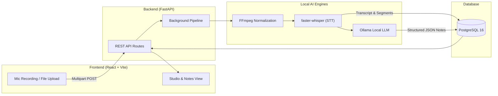

# 🎙️ Voice to Notes AI

<div align="center">

[](https://fastapi.tiangolo.com/)
[](https://react.dev/)
[](https://tailwindcss.com/)
[](https://github.com/SYSTRAN/faster-whisper)
[](https://ollama.com/)
[](https://www.postgresql.org/)
[](LICENSE)

An end-to-end, **100% local-first** voice-to-notes web application. Record audio directly in the browser or upload an audio file, transcribe it locally with **faster-whisper**, and synthesize structured notes, executive summaries, and action items using a **local LLM running on Ollama**, with full persistence in **PostgreSQL**.

[Features](#-key-features) • [Architecture](#-architecture) • [Quick Start](#-quick-start) • [API Contract](#-api-contract) • [Testing](#-testing--verification) • [Author](#-author)

</div>

---

## ✨ Key Features

- 🎙️ **Browser Audio Recording:** Live microphone capture using the MediaRecorder API with active timer, audio waveform indicator, and pause/resume controls.
- 📂 **Multi-format Audio Upload:** Drag-and-drop file upload supporting `.wav`, `.mp3`, `.m4a`, `.webm`, `.ogg`, `.aac`, and `.flac` (up to 100MB).
- ⚙️ **FFmpeg Normalization:** Automatic audio stream inspection and conversion to 16kHz mono WAV for optimal speech recognition.
- ⚡ **Local Speech Recognition:** Local transcription powered by `faster-whisper` (CTranslate2) with automatic language detection, VAD silence filtering, and precise timestamped segments.
- 🧠 **Structured Note Synthesis:** Local LLM inference via `Ollama` (`qwen2.5:3b`) extracting:
  - **Descriptive Title**
  - **Executive Summary**
  - **Key Points & Discussion Highlights**
  - **Action Items** (with assigned owners, deadlines, and interactive completion checkboxes)
  - **Keyword Tags**
- 🗄️ **Relational PostgreSQL Storage:** Persistent storage for audio metadata, background jobs, transcripts, segments, and notes.
- 📥 **One-Click Export:** Download notes in clean Markdown (`.md`) or formatted Plain Text (`.txt`).
- 🔒 **Privacy First:** 100% offline local inference — zero audio or transcripts leave your machine.

---

## 🏗️ Architecture



---

## 🛠️ Tech Stack

| Layer | Technology | Purpose |
|---|---|---|
| **Frontend** | React 18, Vite, Tailwind CSS, Lucide Icons | Responsive modern studio UI & note editor |
| **Backend** | Python 3.12, FastAPI, Pydantic V2 | REST API, background worker, and audio routing |
| **Speech-to-Text** | `faster-whisper` (CTranslate2, int8) | High-speed local speech recognition |
| **Audio Processing** | FFmpeg & ffprobe | Audio inspection, duration checks, and 16kHz WAV conversion |
| **Local LLM** | Ollama (`qwen2.5:3b`) | Local structured note, summary, and action items synthesis |
| **Database** | PostgreSQL 16, SQLAlchemy 2.0 | Relational persistence for audio, jobs, transcripts & notes |

---

## 🚀 Quick Start

### 1. Prerequisites

Ensure you have the following installed on your system:
- **Python 3.10+** (Python 3.12 recommended)
- **Node.js 18+** & npm
- **FFmpeg** (`brew install ffmpeg`)
- **Ollama** ([ollama.com](https://ollama.com))
- **PostgreSQL 15+**

```bash
# Pull the local LLM model
ollama serve
ollama pull qwen2.5:3b
```

### 2. Configure Database

```sql
CREATE USER voice_notes WITH PASSWORD 'change-this-password';
CREATE DATABASE voice_notes OWNER voice_notes;
```

### 3. One-Click Launch (macOS / Linux)

Run the included launch script to start PostgreSQL, Ollama, FastAPI backend, and React frontend automatically:

```bash
chmod +x run.sh
./run.sh
```

- **Web App:** [http://localhost:5173](http://localhost:5173)
- **Backend API:** [http://127.0.0.1:8000](http://127.0.0.1:8000)
- **Swagger Docs:** [http://127.0.0.1:8000/docs](http://127.0.0.1:8000/docs)

---

## 💻 Manual Setup

If you prefer running services in separate terminals:

#### Backend:
```bash
# 1. Virtual environment setup
python3.12 -m venv backend/.venv
source backend/.venv/bin/activate

# 2. Install dependencies
pip install -r backend/requirements.txt

# 3. Environment configuration
cp .env.example backend/.env

# 4. Start backend server
export PYTHONPATH=backend
uvicorn app.main:app --host 127.0.0.1 --port 8000 --reload
```

#### Frontend:
```bash
cd frontend
npm install
npm run dev
```

---

## 📡 API Contract

| Method | Endpoint | Description |
|---|---|---|
| `GET` | `/health` | System health check (PostgreSQL, Ollama, Whisper status) |
| `POST` | `/api/v1/audio` | Upload audio file / recording & start processing job |
| `GET` | `/api/v1/jobs/{job_id}` | Poll processing stage and progress |
| `GET` | `/api/v1/transcripts/{id}` | Retrieve transcript with timestamped segments |
| `GET` | `/api/v1/notes` | List saved notes (with optional `?search=` filter) |
| `GET` | `/api/v1/notes/{id}` | Get single note with action items |
| `PATCH` | `/api/v1/notes/{id}` | Update note title, summary, or content |
| `PATCH` | `/api/v1/notes/{id}/action-items/{item_id}` | Toggle action item completion status |
| `POST` | `/api/v1/notes/generate` | Re-generate notes with custom prompt instructions |
| `DELETE` | `/api/v1/notes/{id}` | Delete note and cascade clean audio from disk |
| `GET` | `/api/v1/notes/{id}/export?format=md` | Export note as Markdown (`.md`) or Text (`.txt`) |

---

## 🧪 Testing & Verification

Run the comprehensive pytest suite:
```bash
PYTHONPATH=backend backend/.venv/bin/pytest backend/tests/test_api.py -v
```

Run full end-to-end pipeline verification (real audio sample $\rightarrow$ faster-whisper $\rightarrow$ Ollama $\rightarrow$ PostgreSQL $\rightarrow$ Markdown export without mocks):
```bash
backend/.venv/bin/python test_e2e.py
```

---

## 📁 Repository Structure

```text
voice-to-notes/
├── backend/
│   ├── app/
│   │   ├── api/routes/          # REST endpoints (health, audio, notes)
│   │   ├── core/                # App configuration (pydantic-settings)
│   │   ├── database/            # SQLAlchemy session and Base
│   │   ├── models/              # Relational models (AudioFile, Note, ActionItem...)
│   │   ├── schemas/             # Pydantic V2 schemas
│   │   ├── services/            # Services (AudioService, Transcription, Notes)
│   │   ├── workers/             # Background pipeline worker
│   │   └── main.py              # FastAPI application entrypoint
│   ├── tests/                   # Backend pytest suite
│   └── requirements.txt
├── frontend/
│   ├── src/
│   │   ├── components/          # React components (AudioCapture, NotesView...)
│   │   ├── services/            # Frontend API client
│   │   ├── App.jsx              # Main responsive layout
│   │   └── main.jsx
│   ├── index.html
│   ├── tailwind.config.js
│   └── vite.config.js
├── storage/audio/               # Local audio storage
├── .env.example
├── .gitignore
├── run.sh                       # One-click launcher script
├── test_e2e.py                  # End-to-end integration test
└── README.md
```

---

## 👨💻 Author

<div align="center">

<a href="https://github.com/iitking">
  
</a>

### **Nivesh Kumar Meena**

**AI Architect · MLOps Engineer** | B.Tech Electrical Engineering, **IIT Roorkee**

*Building agentic AI systems, RAG pipelines and production-ready ML.*

<a href="https://www.linkedin.com/in/nivesh-kumar-meena-a31465221/"></a>
<a href="https://github.com/iitking"></a>
<a href="mailto:niveshkr149@gmail.com"></a>

<br/><br/>

⭐ **If you found this project useful, please give it a star!** ⭐

<sub>Open to AI/ML engineering opportunities and collaborations.</sub>

</div>

---

<div align="center">
  <sub>Made with ❤️ by <a href="https://github.com/iitking">Nivesh Kumar Meena</a> · © 2026 · MIT License</sub>
</div>
