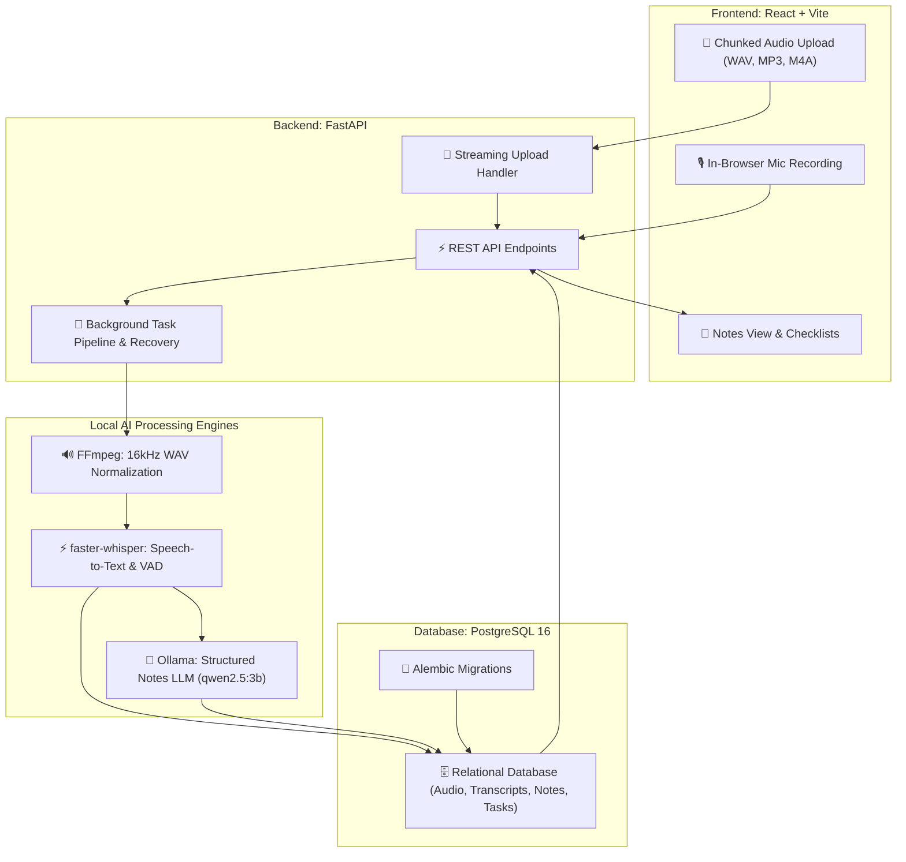

# 🎙️ Voice to Notes AI

<div align="center">

[](https://fastapi.tiangolo.com/)
[](https://react.dev/)
[](https://tailwindcss.com/)
[](https://github.com/SYSTRAN/faster-whisper)
[](https://ollama.com/)
[](https://www.postgresql.org/)
[](https://alembic.sqlalchemy.org/)
[](LICENSE)

An end-to-end, **100% local-first** voice-to-notes web application. Record audio directly in the browser or upload an audio file, transcribe it locally with **faster-whisper**, and synthesize structured notes, executive summaries, and action items using a **local LLM running on Ollama**, with full persistence in **PostgreSQL**.

[Features](#-key-features) • [Architecture](#-architecture) • [Security & Single-User Model](#-security--single-user-architecture) • [Quick Start](#-quick-start) • [Database Migrations](#-database-migrations-alembic) • [API Contract](#-api-contract) • [Testing](#-testing--verification) • [Author](#-author)

</div>

---

## ✨ Key Features

- 🎙️ **Browser Audio Recording:** Live microphone capture using the MediaRecorder API with active timer, audio waveform indicator, and pause/resume controls.
- ⚡ **Chunked Streaming Upload:** High-performance 1MB streaming chunk uploads with strict real-time size limit enforcement (up to 100MB) preventing RAM bloat under concurrent load.
- 📂 **Multi-format Audio Upload:** Drag-and-drop file upload supporting `.wav`, `.mp3`, `.m4a`, `.webm`, `.ogg`, `.aac`, and `.flac`.
- ⚙️ **FFmpeg Normalization:** Automatic audio stream inspection and conversion to 16kHz mono WAV for optimal speech recognition.
- ⚡ **Local Speech Recognition:** Local transcription powered by `faster-whisper` (CTranslate2) with automatic language detection, VAD silence filtering, and precise timestamped segments.
- 🧠 **Structured Note Synthesis:** Local LLM inference via `Ollama` (`qwen2.5:3b`) extracting:
  - **Descriptive Title**
  - **Executive Summary**
  - **Key Points & Discussion Highlights**
  - **Action Items** (with assigned owners, deadlines, and interactive completion checkboxes)
  - **Keyword Tags**
- 🗄️ **Relational PostgreSQL Storage:** Persistent storage for audio metadata, background jobs, transcripts, segments, and notes with **Alembic** schema migrations.
- 🔄 **Resilient Background Processing:** Asynchronous job execution with startup recovery that automatically detects and clears dangling jobs if the server restarts.
- 🌐 **Dynamic CORS Security:** Environment-driven CORS configuration safeguarding REST endpoints.
- 📥 **One-Click Export:** Download notes in clean Markdown (`.md`) or formatted Plain Text (`.txt`).
- 🔒 **Privacy First:** 100% offline local inference — zero audio or transcripts leave your machine.

---

## 🏗️ Architecture



---

### 🔄 End-to-End Processing Pipeline

| Stage | Component | Engine / Tool | Input | Output / Result |
|:---:|:---|:---|:---|:---|
| **1** | **Audio Capture** | Browser MediaRecorder / Dropzone | Microphone speech or audio file | Audio Blob (`.wav`, `.mp3`, `.m4a`, etc.) |
| **2** | **Streaming Ingestion** | FastAPI Server (`POST /api/v1/audio`) | Chunked Multipart Stream | Secure UUID audio file on disk (low RAM) & queued job |
| **3** | **Audio Normalization** | FFmpeg & ffprobe CLI | Raw audio file | Validated 16kHz 16-bit mono WAV |
| **4** | **Speech Recognition** | `faster-whisper` (CTranslate2, int8) | 16kHz mono WAV | Full text transcript & timestamped segments |
| **5** | **AI Note Synthesis** | `Ollama` (`qwen2.5:3b`) | Transcript text | Title, summary, key points, tasks & tags |
| **6** | **Persistence & Export** | PostgreSQL 16 & React Frontend | Structured JSON output | Interactive checklist UI & `.md`/`.txt` download |

---

## 🔒 Security & Single-User Architecture

> [!NOTE]
> **Single-User Workstation Design:**
> This project is intentionally engineered as a **local-first, privacy-centric single-user application**. All audio files, transcripts, vector/relational databases, and LLM inferences remain strictly on the host workstation (`localhost`). It does not include multi-tenant user authentication (RBAC) by design, prioritizing zero cloud reliance, zero external data leakage, and low setup friction.

If you deploy this application to an internal network or remote server, it is recommended to place it behind an authenticating reverse proxy:
- **Reverse Proxy / TLS:** Nginx, Caddy, or Traefik terminating HTTPS.
- **Authentication Layer:** Basic Auth, Cloudflare Access, Authelia, or an OAuth2 Proxy protecting both the frontend and `/api/*` routes.
- **CORS Management:** Configure `CORS_ORIGINS` in `.env` to restrict cross-origin requests to your trusted domain.

---

## 🔄 Background Job Resilience & Scaling

- **FastAPI Lifespan Startup Recovery:** If the backend crashes or restarts during an active transcription or note generation task, the server automatically queries all pending jobs (`queued`, `validating`, `transcribing`, `generating_notes`) and transitions them to `failed` with code `SERVER_INTERRUPTED`, preventing ghost states in the user interface.
- **Scaling to Distributed Queues (Celery + Redis):**
  For enterprise or high-concurrency production deployments where jobs must survive node restarts and scale across multiple worker processes:
  1. Add Redis: `docker run -d -p 6379:6379 redis:7-alpine`
  2. Swap `BackgroundTasks.add_task` with a Celery task:
     ```python
     # Example Celery task definition
     @celery_app.task(bind=True, max_retries=3)
     def celery_audio_pipeline(self, job_id: str, audio_file_id: str, language: str):
         run_audio_pipeline(job_id=job_id, audio_file_id=audio_file_id, language=language)
     ```
  3. Run separate Celery worker daemons: `celery -A app.workers.celery worker --loglevel=info -c 4`

---

## 🛠️ Tech Stack

| Layer | Technology | Purpose |
|---|---|---|
| **Frontend** | React 18, Vite, Tailwind CSS, Lucide Icons | Responsive modern studio UI & note editor |
| **Backend** | Python 3.12, FastAPI, Pydantic V2 | REST API, streaming ingest, and audio routing |
| **Speech-to-Text** | `faster-whisper` (CTranslate2, int8) | High-speed local speech recognition |
| **Audio Processing** | FFmpeg & ffprobe | Audio inspection, duration checks, and 16kHz WAV conversion |
| **Local LLM** | Ollama (`qwen2.5:3b`) | Local structured note, summary, and action items synthesis |
| **Database** | PostgreSQL 16, SQLAlchemy 2.0 | Relational persistence for audio, jobs, transcripts & notes |
| **Migrations** | Alembic | Version-controlled schema migrations |

---

## 🚀 Quick Start

### 1. Prerequisites

Ensure you have the following installed on your system:
- **Python 3.10+** (Python 3.12 recommended)
- **Node.js 18+** & npm
- **FFmpeg** (`brew install ffmpeg`)
- **Ollama** ([ollama.com](https://ollama.com))
- **PostgreSQL 15+**

```bash
# Pull the local LLM model
ollama serve
ollama pull qwen2.5:3b
```

### 2. Configure Database

```sql
CREATE USER voice_notes WITH PASSWORD 'change-this-password';
CREATE DATABASE voice_notes OWNER voice_notes;
```

### 3. One-Click Launch (macOS / Linux)

Run the included launch script to start PostgreSQL, Ollama, FastAPI backend, and React frontend automatically:

```bash
chmod +x run.sh
./run.sh
```

- **Web App:** [http://localhost:5173](http://localhost:5173)
- **Backend API:** [http://127.0.0.1:8000](http://127.0.0.1:8000)
- **Swagger Docs:** [http://127.0.0.1:8000/docs](http://127.0.0.1:8000/docs)

---

## 📜 Database Migrations (Alembic)

Database schema migrations are managed via **Alembic**:

```bash
# Apply migrations to database
cd backend
.venv/bin/alembic upgrade head

# Create a new migration revision after model changes
.venv/bin/alembic revision -m "add_new_column"
```

---

## 💻 Manual Setup

If you prefer running services in separate terminals:

#### Backend:
```bash
# 1. Virtual environment setup
python3.12 -m venv backend/.venv
source backend/.venv/bin/activate

# 2. Install dependencies
pip install -r backend/requirements.txt

# 3. Environment configuration
cp .env.example backend/.env

# 4. Run database migrations
cd backend && alembic upgrade head && cd ..

# 5. Start backend server
export PYTHONPATH=backend
uvicorn app.main:app --host 127.0.0.1 --port 8000 --reload
```

#### Frontend:
```bash
cd frontend
npm install
npm run dev
```

---

## 📡 API Contract

| Method | Endpoint | Description |
|---|---|---|
| `GET` | `/health` | System health check (PostgreSQL, Ollama, Whisper status) |
| `POST` | `/api/v1/audio` | Upload audio stream & start asynchronous processing job |
| `GET` | `/api/v1/jobs/{job_id}` | Poll processing stage and progress |
| `GET` | `/api/v1/transcripts/{id}` | Retrieve transcript with timestamped segments |
| `GET` | `/api/v1/notes` | List saved notes (with optional `?search=` filter) |
| `GET` | `/api/v1/notes/{id}` | Get single note with action items |
| `PATCH` | `/api/v1/notes/{id}` | Update note title, summary, or content |
| `PATCH` | `/api/v1/notes/{id}/action-items/{item_id}` | Toggle action item completion status |
| `POST` | `/api/v1/notes/generate` | Re-generate notes with custom prompt instructions |
| `DELETE` | `/api/v1/notes/{id}` | Delete note and cascade clean audio from disk |
| `GET` | `/api/v1/notes/{id}/export?format=md` | Export note as Markdown (`.md`) or Text (`.txt`) |

---

## 🧪 Testing & Verification

Run the comprehensive pytest suite:
```bash
PYTHONPATH=backend backend/.venv/bin/pytest backend/tests/test_api.py -v
```

Run full end-to-end pipeline verification (real audio sample $\rightarrow$ faster-whisper $\rightarrow$ Ollama $\rightarrow$ PostgreSQL $\rightarrow$ Markdown export without mocks):
```bash
backend/.venv/bin/python test_e2e.py
```

---

## 📁 Repository Structure

```text
voice-to-notes/
├── backend/
│   ├── alembic/                 # Alembic migration environment & revisions
│   │   ├── versions/            # Schema migration scripts
│   │   └── env.py
│   ├── app/
│   │   ├── api/routes/          # REST endpoints (health, audio, notes)
│   │   ├── core/                # App configuration (pydantic-settings)
│   │   ├── database/            # SQLAlchemy session and Base
│   │   ├── models/              # Relational models (AudioFile, Note, ActionItem...)
│   │   ├── schemas/             # Pydantic V2 schemas
│   │   ├── services/            # Services (AudioService, Transcription, Notes)
│   │   ├── workers/             # Background pipeline worker
│   │   └── main.py              # FastAPI application entrypoint with lifespan recovery
│   ├── tests/
│   │   ├── fixtures/            # Test audio samples (WAV fixtures)
│   │   └── test_api.py          # Backend pytest suite
│   ├── alembic.ini              # Alembic configuration
│   └── requirements.txt
├── frontend/
│   ├── src/
│   │   ├── components/          # React components (AudioCapture, NotesView...)
│   │   ├── services/            # Frontend API client
│   │   ├── App.jsx              # Main responsive layout
│   │   └── main.jsx
│   ├── index.html
│   ├── tailwind.config.js
│   └── vite.config.js
├── storage/audio/               # Local audio storage
├── .env.example
├── .gitignore
├── run.sh                       # One-click launcher script
├── test_e2e.py                  # End-to-end integration test with auto-fixture generator
└── README.md
```

---

## 👨‍💻 Author

<div align="center">

<a href="https://github.com/iitking">
  
</a>

### **Nivesh Kumar Meena**

**AI Architect · MLOps Engineer** | B.Tech Electrical Engineering, **IIT Roorkee**

*Building agentic AI systems, RAG pipelines and production-ready ML.*

<a href="https://www.linkedin.com/in/nivesh-kumar-meena-a31465221/"></a>
<a href="https://github.com/iitking"></a>
<a href="mailto:niveshkr149@gmail.com"></a>

<br/><br/>

⭐ **If you found this project useful, please give it a star!** ⭐

<sub>Open to AI/ML engineering opportunities and collaborations.</sub>

</div>

---

<div align="center">
  <sub>Made with ❤️ by <a href="https://github.com/iitking">Nivesh Kumar Meena</a> · © 2026 · MIT License</sub>
</div>
